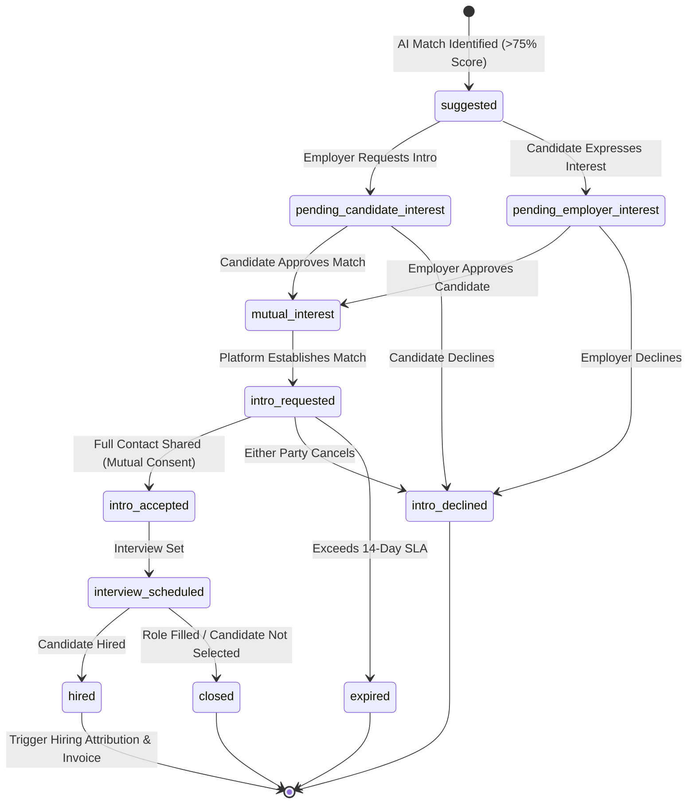

# Marketplace & Network — AI-Powered Talent Network & Direct Introduction Engine
## Architectural Design & Production Implementation Plan

---

## 1. Executive Summary & Vision

The **Marketplace & Network module** transforms Rectech CRM / Aurrum into an intelligent, double-sided talent marketplace and direct introduction platform inspired by the Jack & Jill marketplace model.

### Core Philosophy
* **No Mass Job Applications & No Unsolicited Spam**: Traditional job boards suffer from low-signal applicant floods; traditional recruiting suffers from unsolicited cold outreach. The Talent Network operates strictly on **permissioned discoverability, algorithmic qualification matching, and mutual-interest direct introductions**.
* **Zero Candidate Fees**: Marketplace access, matching, and introductions remain 100% free for candidates.
* **Employer / Sourcing Partner Monetization**: Monetization is triggered strictly upon verified qualifying hire confirmation, attributed cleanly to the introduction thread and connected to Rectech CRM's invoice generation engine.
* **Privacy by Default**: Candidate contact information and identifying details remain shielded until a mutual introduction is officially requested and accepted by both parties.

---

## 2. Comprehensive Repository Audit & Architectural Foundation

### 2.1 Existing Codebase Inventory
| System Layer | Current Implementation in Codebase | Extension Strategy for Marketplace |
| :--- | :--- | :--- |
| **Frontend Framework** | React 19, Vite, Tailwind CSS 4, Poppins typography, Lucide React icons. | Build modular UI components following the Aurrum design system (Navy `#003E5A`, Gold `#BA9E6A`). |
| **Routing** | `react-router-dom` in `src/App.tsx`, with routes `/dashboard`, `/ai-job-discovery`, `/candidate/:id`, `/invoice-builder`. | Extend `/dashboard` tabs and add dedicated sub-views for Talent Network, Introductions, and Candidate Marketplace. |
| **Authentication & RBAC** | Firebase Auth (`useAuth`) with roles: `admin`, `team_leader`, `recruiter`, `client`, `developer`. | Candidate role mapped to talent profiles; Employers mapped to `client` role; Agencies/Recruiters mapped to `recruiter`/`team_leader`. |
| **Database & Firestore** | Cloud Firestore instance `aurrum-production`, collections: `candidates`, `marketplace_jobs`, `candidate_job_interactions`, `invoices`, `activity_logs`. | Add collections: `marketplace_profiles`, `direct_introductions`, `hiring_attributions`, `marketplace_consents`. |
| **Matching & AI Service** | `src/services/recommendationEngine.ts` (deterministic qualification check, weighted scoring) & Gemini AI. | Expand to bidirectional candidate-to-job & job-to-candidate continuous background matching. |
| **Invoicing & Billing** | `src/components/InvoiceBuilder.tsx` & `src/services/invoiceService.ts` with placement fee calculations. | Hook confirmed hires into `hiring_attributions` and auto-generate placement fee draft invoices. |
| **Notifications** | `NotificationContext.tsx`, `ToastContext.tsx`, and in-app sound/badge listeners. | Add event triggers for *Intro Requested*, *Mutual Match*, *Intro Accepted*, *Interview Scheduled*, and *Hire Confirmed*. |

---

## 3. Data Model & Firestore Schema Architecture

### 3.1 `marketplace_profiles` (Extended Candidate Marketplace Record)
```typescript
export type MarketplaceVisibilityState = 'not_opted_in' | 'discoverable' | 'paused' | 'withdrawn';

export interface MarketplaceProfile {
  id: string; // matches candidateId
  candidateId: string;
  fullName: string;
  headline: string;
  summary: string;
  skills: string[];
  totalExperienceYears: number;
  industries: string[];
  preferredTitles: string[];
  preferredLocations: string[];
  workArrangement: 'remote' | 'hybrid' | 'on-site' | 'flexible';
  employmentType: 'full-time' | 'contract' | 'part-time';
  desiredSalaryMin?: number;
  desiredSalaryMax?: number;
  salaryCurrency: string;
  availability: 'immediate' | '2_weeks' | '1_month' | 'exploring';
  visibility: MarketplaceVisibilityState;
  anonymized: boolean; // shields email, phone, and current employer until intro accepted
  optedInAt?: string;
  pausedAt?: string;
  withdrawnAt?: string;
  lastActiveAt: string;
  verifiedQualifications: string[];
  consentVersion: string;
}
```

### 3.2 `direct_introductions` (Mutual-Fit Introduction Thread)
```typescript
export type IntroductionStatus = 
  | 'suggested'
  | 'pending_candidate_interest'
  | 'pending_employer_interest'
  | 'mutual_interest'
  | 'intro_requested'
  | 'intro_accepted'
  | 'intro_declined'
  | 'interview_scheduled'
  | 'hired'
  | 'closed'
  | 'expired';

export interface DirectIntroduction {
  id: string;
  candidateId: string;
  candidateName: string;
  candidateEmail: string; // hidden until status is intro_accepted
  jobId: string;
  jobTitle: string;
  companyName: string;
  clientId: string; // employer account ID
  recruiterId?: string; // agency or sourcing recruiter ID
  matchScore: number;
  matchReasons: string[];
  status: IntroductionStatus;
  statusHistory: Array<{
    status: IntroductionStatus;
    changedAt: string;
    changedBy: string;
    note?: string;
  }>;
  candidateInterestTimestamp?: string;
  employerInterestTimestamp?: string;
  introAcceptedTimestamp?: string;
  interviewScheduledDate?: string;
  hiredDate?: string;
  expiresAt: string; // 14-day SLA window
  createdAt: string;
  updatedAt: string;
}
```

### 3.3 `hiring_attributions` (Placement Fee Monetization Record)
```typescript
export type AttributionBillingStatus = 'pending_verification' | 'invoice_drafted' | 'invoiced' | 'paid' | 'disputed';

export interface HiringAttribution {
  id: string;
  introductionId: string;
  candidateId: string;
  candidateName: string;
  jobId: string;
  jobTitle: string;
  clientId: string;
  clientName: string;
  agencyId?: string;
  hireConfirmedAt: string;
  confirmedBy: string;
  annualSalaryAgreed: number;
  currency: string;
  feeModel: 'percentage_of_ctc' | 'fixed_success_fee';
  feeRate: number; // e.g. 15% or 5000 fixed
  totalFeeAmount: number;
  billingStatus: AttributionBillingStatus;
  invoiceId?: string;
  notes?: string;
}
```

---

## 4. State Machine: Mutual-Fit Direct Introduction



---

## 5. Implementation Phases & Action Plan

### Phase 1: Architecture & Type Contracts (`src/types/marketplace.ts`)
- Define strict TypeScript interfaces for `MarketplaceProfile`, `DirectIntroduction`, `IntroductionStatus`, `HiringAttribution`, and `MarketplaceAnalytics`.
- Standardize compatibility with existing `Candidate` and `JobOpening` schemas.

### Phase 2: Candidate Opt-In & Privacy State Machine
- Build `src/services/marketplaceService.ts` for managing opt-in, pausing, and withdrawing discoverability.
- Implement anonymization logic: hides contact info (`email`, `phone`, `currentCompany`) from unapproved employer searches until intro is accepted.

### Phase 3: Continuous Background Matching Engine & REST APIs
- Extend `server.ts` with REST endpoints:
  - `GET /api/marketplace/candidates/discoverable` — Search talent network with strict visibility filter.
  - `POST /api/marketplace/candidates/opt-in` — Candidate opt-in and preference update.
  - `GET /api/marketplace/introductions` — Fetch introductions with role-based visibility.
  - `POST /api/marketplace/introductions/request` — Initiate introduction request.
  - `POST /api/marketplace/introductions/respond` — Accept or decline an introduction with state transition validation.
  - `POST /api/marketplace/attribution/hire` — Report confirmed hire & generate invoice link.
  - `GET /api/marketplace/network-analytics` — Sourcing metrics, match health, and introduction funnel.

### Phase 4: Frontend Views & Interactive Workspaces
- **Talent Network Discovery Tab**: Employers & Recruiters search opted-in candidate profiles, view AI fit breakdown, and send introduction requests.
- **Direct Introductions Management Center**: Interactive kanban/table tracking intro stages from *Suggested* to *Interview* and *Hired*.
- **Candidate Network Profile & Privacy Modal**: Candidate-facing controls for setting visibility (`discoverable`, `paused`, `withdrawn`), salary bounds, and remote preferences.
- **Hiring Attribution & Monetization Modal**: Record verified hire and automatically draft placement invoice in Rectech Invoices.

### Phase 5: Testing, Quality Assurance & Verification
- Verify candidate opt-out guarantees: non-opted-in candidates NEVER appear in marketplace discovery.
- Verify mutual consent enforcement: contact details remain hidden until both parties accept.
- Verify production build (`npm run build`) and hot deployment.

---

## 6. Verification Checklist
- [x] Full application audit completed
- [ ] TypeScript contracts in `src/types/marketplace.ts`
- [ ] Backend API endpoints in `server.ts`
- [ ] Matching & Introduction Service in `src/services/marketplaceService.ts`
- [ ] Talent Network Search & Discovery UI component
- [ ] Direct Introduction Workflow UI component
- [ ] Candidate Privacy & Opt-In Settings modal
- [ ] Integration with Rectech Invoicing
- [ ] Unit & integration verification scripts
- [ ] Production build and Git commit to `development`
